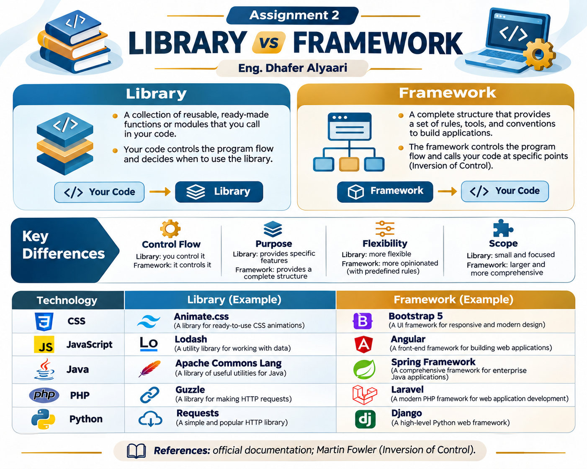

# Assignment 2 — Library vs. Framework

**Student:** Eng. Dhafer Alyaari  
**Task:** Explain the difference between Library and Framework, with examples from CSS, JavaScript, Java, PHP, and Python.

## The main difference | الفرق الأساسي

- **Library:** Your code calls the library when needed. / **المكتبة:** برنامجك يستدعي وظائفها عند الحاجة.
- **Framework:** It provides a structure and often calls your code. / **إطار العمل:** يوفر بنية للتطبيق، وغالبًا يستدعي كودك أثناء التنفيذ.

| Technology | Library | Framework |
|---|---|---|
| CSS | Animate.css | Bootstrap 5 |
| JavaScript | Lodash | Angular |
| Java | Apache Commons Lang | Spring Framework |
| PHP | Guzzle | Laravel |
| Python | Requests | Django |

**Note:** In CSS, “framework” usually means a UI styling system, rather than program execution control.

## Infographic

## Files

- [Research_Report.pdf](Research_Report.pdf) — A short bilingual report for reading or printing.
- [Research_Comparison.md](Research_Comparison.md) — The full comparison, practical example and source links.
- [Library_vs_Framework_Infographic.png](Library_vs_Framework_Infographic.png) — Infographic.

**References:** Official documentation for all ten tools and [Martin Fowler — Inversion of Control](https://martinfowler.com/bliki/InversionOfControl.html). All links are in `Research_Comparison.md`.
